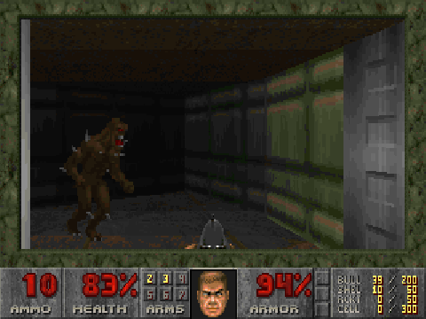
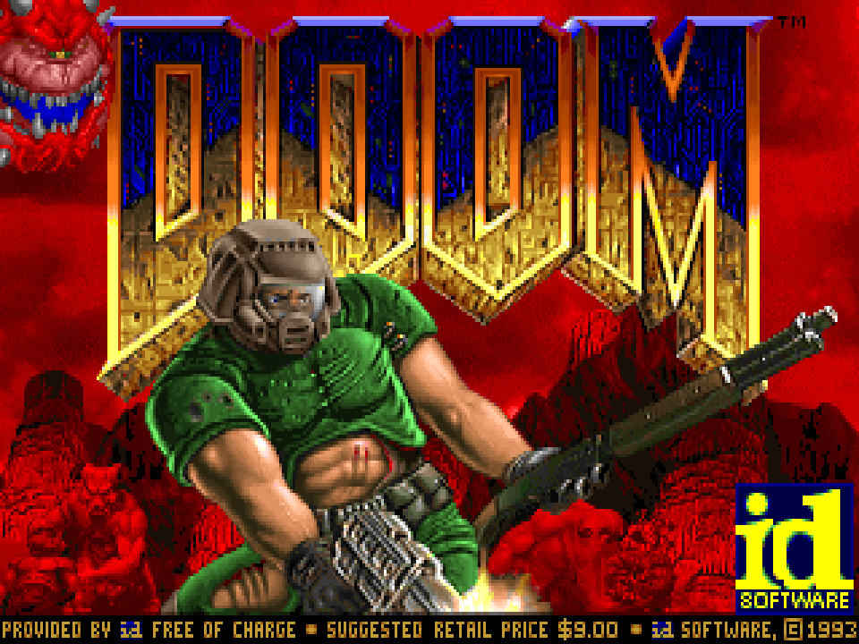
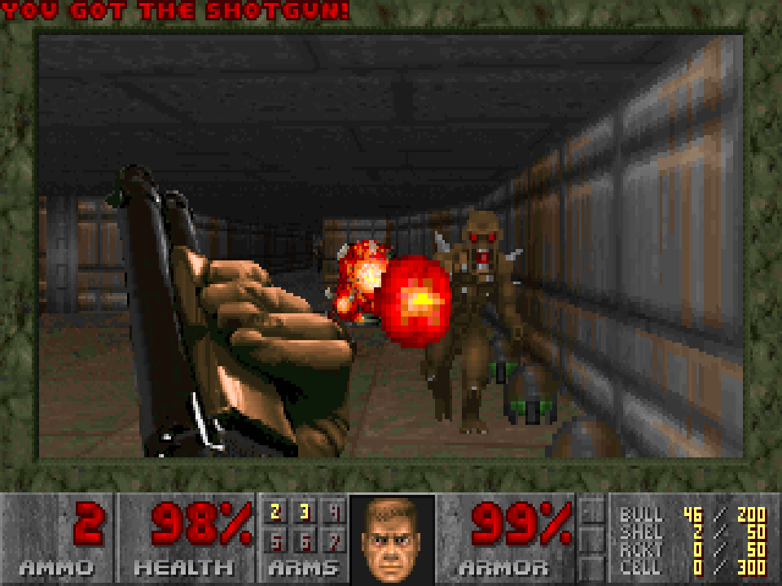
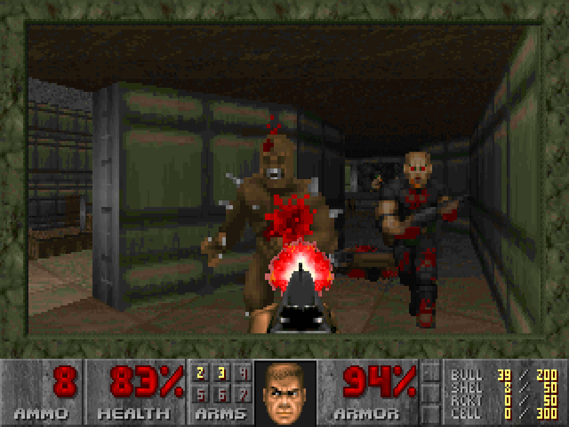
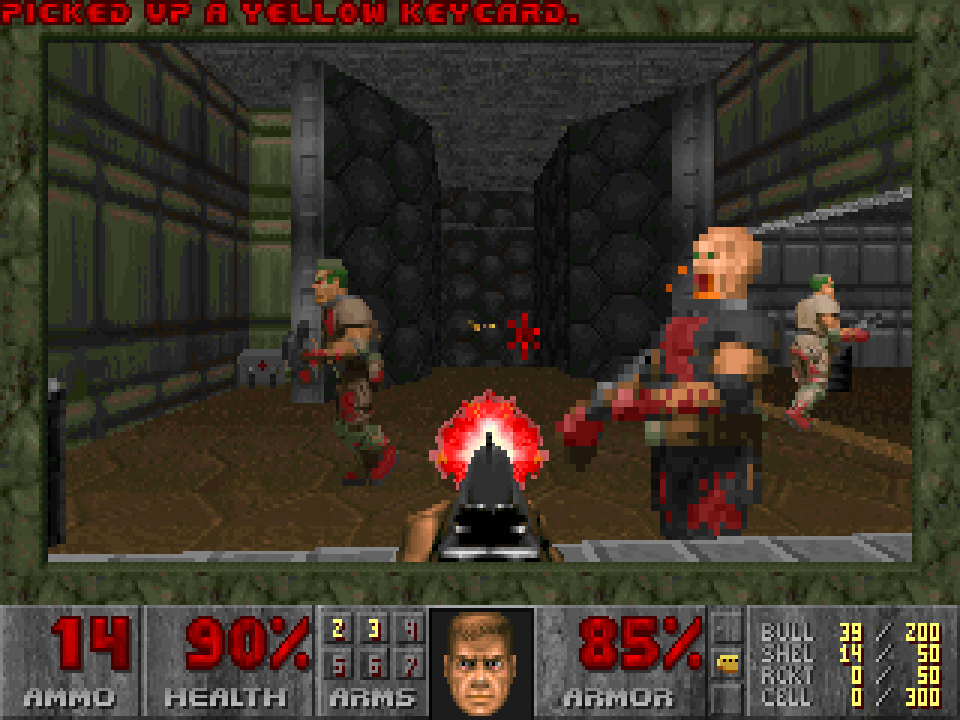

# DOOM en el navegador 🔥

> *«Nunca preguntes si algo puede ejecutar DOOM. Pregunta cuándo.»*

Este repo mete **el DOOM original de 1993** en una pestaña del navegador. No es un remake, ni un clon en JavaScript, ni una versión «inspirada en». Es el **código fuente de id Software**, el mismo que escribieron John Carmack y compañía, compilado a WebAssembly y ejecutándose tal cual.

Abres la página, haces clic y estás en E1M1 con la pistola en la mano y el MIDI de *At Doom's Gate* sonando como en una Sound Blaster de los 90.

<p align="center">
  <a href="https://ablancodev.github.io/doom-html/"></a>
</p>

<p align="center">
  <a href="https://ablancodev.github.io/doom-html/"></a>
</p>

<p align="center"><i>Esto no es un vídeo de YouTube: es la DEMO1 original de 1994, reproducida por el motor de id dentro de Chrome.<br>
🔊 <a href="media/gameplay.mp4">Versión con sonido (MP4, 55 s)</a>: música FM emulada y efectos del mezclador original.</i></p>

| | |
|---|---|
|  |  |
|  |  |

> ⚠️ **Proyecto no oficial.** Es un ejercicio técnico y de aprendizaje. No tiene ninguna relación con id Software, Bethesda, ZeniMax ni Microsoft. DOOM es una marca registrada de id Software.

---

## ¿Por qué?

Últimamente hay mucho hype con los proyectos de **ingeniería inversa y decompilación** de grandes clásicos: Super Mario 64, Zelda: Ocarina of Time, GTA III… La gente desmonta juegos míticos byte a byte y los vuelve a montar para que funcionen en cualquier sitio.

Y yo pensé: vale, muy bien, pero **no hay juego más grande que DOOM**. Es el juego que se ha portado a calculadoras, impresoras, frigoríficos, tests de embarazo y tractores. Faltaba que lo tuviera yo en el navegador, hecho a mi manera.

Una aclaración honesta: esto **no es ingeniería inversa en sentido estricto**, porque id Software tuvo el detalle de liberar el código en 1997, así que no hubo que adivinar nada del motor. Es un **port**: coger un programa escrito para Linux con X11 en los 90 y hacer que funcione en un sitio para el que nunca se pensó. Donde sí entra la ingeniería inversa es en la música. El código liberado venía **sin música** porque dependía de una librería comercial (DMX), y para recuperarla me he apoyado en el trabajo de la comunidad que destripó cómo sonaba aquel driver en DOS.

## ¿Cómo de fiel es?

Mucho. Tanto como para medirlo.

DOOM tiene una propiedad preciosa: es **100 % determinista**. Las demos que ves en la pantalla de título no son vídeos, son grabaciones de las teclas que pulsó un jugador en 1994. Si el motor se desvía lo más mínimo (un redondeo, un número aleatorio fuera de sitio), el jugador de la demo acaba andando contra una pared.

Así que reproduje las tres demos de la versión de DOS y las comparé con [Chocolate Doom](https://www.chocolate-doom.org/), el port de referencia por fidelidad al ejecutable original:

| Demo | Mapa | Tics | Resultado |
|------|------|------|-----------|
| DEMO1 | E1M5 | 5026 | ✅ idéntico |
| DEMO2 | E1M3 | 3836 | ✅ idéntico |
| DEMO3 | E1M7 | 2134 | ✅ idéntico |

Posición, vida y bajas del jugador, comprobadas cada segundo durante más de 10 000 tics. El marine muere en el mismo sitio y en el mismo instante en las dos versiones (sí, en las tres demos acaba muerto; los de id no eran tan buenos 😅).

Y además:
- **35 fotogramas por segundo**, el reloj interno del original.
- **320×200 píxeles con paleta de 256 colores**, estirado a 4:3 como se veía en un monitor CRT.
- **Sonido** con el mezclador original de id.
- **Música FM** emulando el chip Yamaha OPL2 de las AdLib y Sound Blaster.
- La pantalla de texto roja **ENDOOM** al salir, para los nostálgicos de DOS.
- Partidas guardadas que sobreviven aunque cierres el navegador.

## Jugar

Por defecto viene el **episodio 1 shareware** (*Knee-Deep in the Dead*), que id distribuía gratis y se puede compartir legalmente.

¿Tienes el juego completo (Steam, GOG…)? Pulsa **«Cargar tu WAD…»** y elige tu `DOOM.WAD`, `DOOM2.WAD`, `TNT.WAD` o `PLUTONIA.WAD`. El archivo se queda en tu navegador y no se sube a ningún sitio.

| Tecla | Acción |
|-------|--------|
| Flechas | Moverse y girar |
| Ctrl / clic izquierdo | Disparar |
| Espacio | Abrir puertas |
| Shift | Correr |
| Alt + flechas / `,` `.` | Desplazamiento lateral |
| 1 a 7 | Armas |
| Tab | Mapa |
| Esc | Menú |

Truco: escribe `iddqd` durante la partida. Ya sabes lo que hace.

## Compilarlo tú

```sh
brew install emscripten   # o la guía oficial de emscripten.org
make                      # genera public/doom.js y public/doom.wasm
```

Sirve la carpeta `public/` con cualquier servidor web y listo.

## ¿Quieres los detalles técnicos?

Cómo se mete un `while(1)` de 1993 en un navegador que no te deja bloquearlo, por qué el sonido de Linux era peor que el de DOS, qué bugs de hace 30 años me encontré por el camino y cómo se verifica que todo es fiel: está todo en **[TECHNICAL.md](TECHNICAL.md)**.

---

## Quién está detrás

Soy **Antonio Blanco** y me defino como *builder*: me gusta partir de un problema, diseñar la solución y construir algo que funcione, rápido y en público. Normalmente lo hago con IA, WordPress y productos como [GrowthPlugins](https://ablancodev.com). Esta vez el «problema» era que DOOM no estaba en mi navegador. 🙂

Escribo sobre lo que construyo, los errores incluidos, en **[ablancodev.com](https://ablancodev.com)**.

## Licencias

- Código: **GPL v2** (ver [`LICENSE`](LICENSE)), igual que el código liberado por id Software.
- Emulador OPL: [Nuked-OPL3](https://github.com/nukeykt/Nuked-OPL3), LGPL 2.1+.
- Tablas del driver de música: ingeniería inversa de [Chocolate Doom](https://github.com/chocolate-doom/chocolate-doom), GPL v2+.
- `DOOM1.WAD` shareware v1.9: © id Software, redistribuible sin modificar y gratis.
- DOOM es una marca registrada de id Software. Proyecto no oficial.
